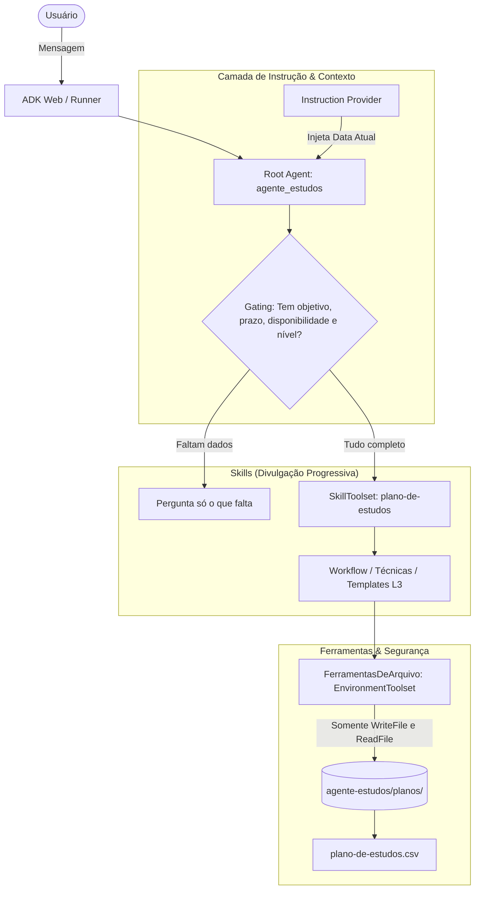

# 🎓 StudyMentor AI — Agente Especialista em Planos de Estudo com Google ADK

[](https://www.python.org/)
[](https://adk.dev/)
[](https://aistudio.google.com/)
[](https://docs.astral.sh/uv/)
[](LICENSE)

> **Proof of Concept (PoC)** desenvolvida durante a **Imersão Engenharia de Software: Dev na Era da IA** da [Alura](https://www.alura.com.br/).  
> Um agente inteligente autônomo baseado em **Google ADK** (Agent Development Kit) e arquitetura orientada a **Agent Skills**, capaz de coletar objetivos de aprendizado, calcular cronogramas com técnicas de revisão espaçada e gerar agendas prontas para importação direta no **Google Agenda (CSV)**.

---

## Contexto e Jornada de Aprendizado

Durante a imersão de 3 aulas intensivas, o foco foi vivenciar a transição de um desenvolvedor tradicional para um **Engenheiro de Software que orquestra ferramentas de IA de ponta a ponta**:

1. **Ideação e Prototipagem no Google AI Studio:**
   - Estruturação do comportamento do modelo, parametrização e definição da persona do mentor pedagógico.
2. **Pair Programming com Antigravity CLI (`agy`):**
   - Utilização do `agy` para conduzir o ciclo de vida de desenvolvimento em conjunto com a IA, utilizando comandos como `/grill-me` para alinhar requisitos de arquitetura antes de escrever código.
3. **Google ADK (Agent Development Kit) & `agents-cli`:**
   - Construção de agentes seguindo convenções corporativas oficiais da Google, com separação de responsabilidades, scaffolding automatizado e interfaces de desenvolvimento local via ADK Web.
4. **Agent Skills & Divulgação Progressiva:**
   - Implementação de habilidades modulares (`SKILL.md`) que ensinam ao agente *como* agir por meio de regras de ativação (*gating*) e carregamento sob demanda de referências e templates (L1, L2 e L3).

---

## Funcionalidades

- **Regra de Gating Inteligente:** Se o usuário não informar os 4 pilares essenciais (**Objetivo**, **Prazo**, **Disponibilidade** e **Nível Atual**), o agente interrompe a execução de ferramentas complexas e faz uma pergunta pontual solicitando apenas o que falta.
- **Pedagogia com Revisão Espaçada:** Distribui os tópicos de estudo aplicando espaçamento temporal e revisões intercaladas para maximizar a retenção.
- **Checkpoints Semanais:** Inclui metas de autoavaliação e entregáveis concretos (exercícios, resumos, mini-projetos) para cada sessão.
- **Exportação para Google Agenda:** Gera automaticamente o arquivo `plano-de-estudos.csv` compatível com o formato nativo de importação do Google Calendar.
- **Capacidade de Replanejamento:** Ajusta dinamicamente as sessões em caso de imprevistos ou faltas sem sobrecarregar um único dia.

---

## Arquitetura e Boas Práticas



### Destaques Técnicos:
- **Segurança Sandbox (`FerramentasDeArquivo`):** O agente utiliza o `EnvironmentToolset` restrito estritamente às operações de leitura e gravação de arquivos na pasta isolada `planos/`, sem conceder qualquer permissão de execução de shell/terminal ao LLM.
- **Injeção Dinâmica de Tempo:** A instrução do agente calcula em tempo de execução a data e o dia da semana atual (`InstructionProvider`), permitindo compreender expressões como *"começo na próxima quarta-feira"*.
- **Divulgação Progressiva (L1/L2/L3):** O prompt inicial carrega apenas os metadados da skill. Detalhes de templates e metodologias são lidos pelo agente sob demanda via ferramentas dedicadas (`load_skill_resource`), economizando tokens e evitando alucinações.
- **Zero Secrets no Versionamento:** Nenhuma chave de API ou dado de usuário na pasta `planos/` é versionado no Git (`.gitignore` estrito).

---

## Tecnologias Utilizadas

- **Linguagem:** Python 3.11+
- **Framework de Agentes:** [Google ADK](https://adk.dev/) (`google-adk`)
- **Modelos de Linguagem:** Google Gemini via [Google AI Studio](https://aistudio.google.com/) (`gemini-3.5-flash` / `gemini-3.8-flash`)
- **Gerenciador de Pacotes e Ambientes:** [uv](https://astral.sh/uv) (Astral)
- **Scaffolding e Governança:** `google-agents-cli`
- **Ambiente de Pair Programming:** Antigravity CLI (`agy`)

---

## Antigravity CLI (`agy`) — Ambiente de Pair Programming

O desenvolvimento deste projeto foi conduzido utilizando o **[Antigravity CLI (`agy`)](https://antigravity.google/)**, o assistente oficial de desenvolvimento em terminal da Google DeepMind. O `agy` atua diretamente no workspace do projeto, executando comandos, realizando scaffolding, gerando testes e conduzindo o pair programming interativo orientado a **Agent Skills**.

### 1. Instalação no Terminal

- **Windows (PowerShell):**
  ```powershell
  irm https://antigravity.google/cli/install.ps1 | iex
  ```
- ** Windows (CMD):**
   ```CMD
  curl -fsSL https://antigravity.google/cli/install.cmd -o install.cmd && install.cmd && del install.cmd
  ```

- **Linux / macOS / Cloud Shell (Bash/Zsh):**
  ```bash
  curl -fsSL https://antigravity.google/cli/install.sh | bash
  ```

> **Dica pós-instalação:** Feche e reabra o terminal para que o comando `agy` fique disponível globalmente no seu `PATH`.

---

### 2. Comandos Essenciais para o Terminal

| Objetivo | Comando | Descrição |
|---|---|---|
| **Iniciar nova sessão** | `agy` | Abre uma nova sessão interativa no diretório atual. |
| **Continuar conversa anterior** *(se fechou sem querer)* | `agy -c`<br>*(ou `agy --continue`)* | Retoma imediatamente o contexto exato da última conversa aberta. |
| **Visualizar conversas anteriores** | `/resume (conversation)` | Lista todas as conversas anteriores. |
| **Retomar uma sessão específica** | `agy --conversation <ID>` | Reabre uma conversa anterior específica utilizando o ID da sessão. |
| **Atualizar o CLI** | `agy update` | Atualiza o Antigravity CLI para a versão mais recente. |

---

### 3. Como Encontrar e Escolher Conversas Anteriores

Todas as conversas, sessões e históricos ficam armazenados localmente no diretório de dados do usuário:

- **Windows:** `%USERPROFILE%\.gemini\antigravity-cli\brain\`
- **Linux/macOS:** `~/.gemini/antigravity-cli/brain/`

Cada subpasta dentro de `brain/` possui o identificador único (UUID) da conversa e contém:
- `logs/transcript.jsonl`: Histórico completo de perguntas, respostas e chamadas de ferramentas.
- Arquivos de rascunho (*scratchpads*) e artefatos produzidos durante a sessão.

Para retomar qualquer uma dessas sessões, basta copiar o identificador da pasta (UUID) e executar:
```powershell
agy --conversation <UUID_DA_CONVERSA>
```

---

### 4. Comandos Úteis Dentro da Sessão do `agy`

- `/grill-me` — Inicia uma entrevista técnica guiada com a IA para debulhar requisitos de arquitetura antes de gerar código.
- `/skills` — Lista todas as habilidades (*skills*) disponíveis no agente de desenvolvimento.
- `/config` — Abre o painel de configurações para definir permissões de ferramentas (ex.: `always-proceed`).
- `/help` — Exibe a lista completa de comandos rápidos disponíveis.
- `/exit` ou `/quit` *(ou pressionar `Ctrl+D` duas vezes)* — Encerra a sessão gravando o histórico com segurança.

---

## Como Executar o Projeto

### 1. Pré-requisitos
- Python 3.11 ou superior
- [uv](https://docs.astral.sh/uv/getting-started/installation/) instalado
- Chave de API do [Google AI Studio](https://aistudio.google.com/apikey)

### 2. Clonar o repositório
```bash
git clone https://github.com/Yur1b01c4/ai-study-planner-adk.git
cd ai-study-planner-adk/agente-estudos
```

### 3. Configurar as variáveis de ambiente
Crie um arquivo `.env` dentro da pasta `agente-estudos/`:

```env
GOOGLE_GENAI_USE_VERTEXAI=FALSE
GEMINI_API_KEY=sua_chave_do_ai_studio_aqui
MODEL=gemini-3.5-flash
```

> **Nota:** É possível utilizar outro modelo como `gemini-3.8-flash` ou outro modelo da sua preferência. O `OpenRouter` [](https://openrouter.ai/) oferece vários modelos gratuitos para você utilizar. Caso sua cota ou a demanda nos servidores do AI Studio retorne status 503, você pode alternar livremente o modelo na variável `MODEL`.

### 4. Sincronizar dependências
```bash
uv sync
```

### 5. Iniciar a interface Web (ADK Web)
```bash
uv run adk web --allow_origins="*"
```

Abra seu navegador em `http://127.0.0.1:8000` e selecione o agente **`app`**.

---

## Casos de Uso e Testes

### Cenário 1: Pedido Incompleto (Validação do Gating)
**Mensagem enviada:**
```text
Quero organizar meus estudos de JavaScript.
```
**Comportamento esperado:** O agente responde solicitando pontualmente:
1. Objetivo específico
2. Prazo e data de início
3. Disponibilidade semanal e horários
4. Nível atual de conhecimento

### Cenário 2: Pedido Completo (Geração do Cronograma e Arquivo)
**Mensagem enviada:**
```text
Quero aprender JavaScript para fazer meu primeiro projeto de portfólio em 5 semanas. Começo segunda que vem. Posso estudar segunda, quarta e sexta, 2h por dia às 19h. Já sei HTML e CSS, mas nunca programei.
```
**Comportamento esperado:** O agente detalha os módulos pedagógicos, apresenta a tabela das semanas e aciona a ferramenta `WriteFile` para salvar o arquivo:
```
agente-estudos/planos/plano-de-estudos.csv
```

### Cenário 3: Importação no Google Agenda
1. Abra o [Google Agenda](https://calendar.google.com/).
2. Acesse **Configurações → Importar e exportar → Importar**.
3. Selecione o arquivo `plano-de-estudos.csv` gerado e escolha o calendário desejado. Todas as sessões serão criadas automaticamente com horário de início, término e entregáveis detalhados na descrição.

---

## Executando os Testes Automatizados

O projeto conta com uma suíte de testes unitários para validar a arquitetura do agente, restrição de ferramentas e injeção dinâmica de datas:

```bash
uv run pytest tests/unit
```

---

## 📚 Aprendizados Adquiridos

- A diferença entre simplesmente "conversar com uma LLM" e construir uma **solução de engenharia de software baseada em agentes com ferramentas delimitadas**.
- Como aplicar o padrão de **Progressive Disclosure** em Agent Skills para economizar contexto e melhorar a aderência às instruções.
- Práticas de **Sandboxing e Least Privilege**, evitando dar acesso irrestrito ao shell para IAs generativas.
- Utilização de CLI modernas (`uv`, `agents-cli`, `agy`) para acelerar o desenvolvimento local.

---

## 📄 Licença

Este projeto é de código aberto sob a licença [MIT](LICENSE).

Agradecimentos à equipe da **[Alura](https://www.alura.com.br/)** pelo conteúdo inspirador da Imersão Dev na Era da IA!
